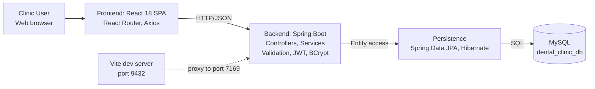

# SmileSync Dental Care Management System

**01CE0308 – Advance Java Technology (AJT) Project**
Faculty of Engineering & Technology, Marwadi University

SmileSync is a web application for organizing day-to-day dental clinic operations. A React frontend talks to a Java Spring Boot backend through REST APIs, and MySQL stores all clinic records via Spring Data JPA and Hibernate.

## Team

| Name | Enrollment No. |
|------|----------------|
| Vadodariya Utsav | 92610120081 |
| Kamti Sahil | 92610120075 |
| Gondaliya Jainil | 92600120119 |

## Table of Contents

- [Objectives](#objectives)
- [Features](#features)
- [Technology Stack](#technology-stack)
- [System Requirements](#system-requirements)
- [System Architecture](#system-architecture)
- [Project Structure](#project-structure)
- [Getting Started](#getting-started)
- [Database](#database)
- [Authentication and Session Management](#authentication-and-session-management)
- [Main Modules](#main-modules)
- [REST API Connectivity](#rest-api-connectivity)
- [Form Validation and Error Handling](#form-validation-and-error-handling)
- [AJT Technologies Used](#ajt-technologies-used)
- [Screenshots](#screenshots)
- [Testing and Verification](#testing-and-verification)
- [Result](#result)
- [Conclusion](#conclusion)

## Objectives

- Develop a browser-based system for routine dental clinic workflows.
- Connect a React user interface to a Java backend using REST APIs.
- Persist patient, doctor, appointment, visit, treatment, and transaction data in MySQL.
- Provide authenticated access using JWT tokens and password hashing with BCrypt.
- Organize common clinic lists such as specialties, payment modes, and OPD statuses.
- Describe the implementation of AJT technologies.

## Features

- Patient registration, search, update, and detail view (with auto-generated UHID)
- Doctor and treatment management
- Appointment booking with overlap checking
- OPD / visit tracking
- Billing and transactions (credit, debit, and balance summaries)
- Dashboard with date-range statistics
- Clinic master lists (specialty, medical alert, designation, document type, payment mode, OPD status)
- JWT-based login with BCrypt-hashed passwords

## Technology Stack

| Layer | Technologies |
|-------|--------------|
| Frontend | React 18, React Router, Vite, Axios, Tailwind CSS |
| Backend | Java 17, Spring Boot 3.3.5, Spring MVC REST controllers |
| Persistence | Spring Data JPA, Hibernate ORM, MySQL Connector/J |
| Database | MySQL (XAMPP / phpMyAdmin for local setup) |
| Authentication | JWT access/refresh tokens, BCrypt |
| Build tools | Apache Maven (backend), Node.js / npm (frontend) |

## System Requirements

- JDK 17 or later
- Maven 3.9 or later
- Node.js 18 or later with npm
- MySQL server (for example, the MySQL module supplied with XAMPP)
- A modern web browser
- An IDE such as Apache NetBeans, IntelliJ IDEA, or Eclipse

## System Architecture

The browser loads the React single-page application. React pages send HTTP requests through Axios to the Spring Boot REST API. Controllers receive requests, services apply business rules and validation, repositories access data through JPA/Hibernate, and MySQL persists the records. For local development, Vite proxies API calls to the backend.

**Request flow:**

```
User → React interface → REST API controller → service/repository → JPA/Hibernate → MySQL
```



## Project Structure

Representative files:

```
dental-clinic-frontend/
└── src/
    ├── App.jsx                     # Frontend entry and routes
    └── pages/
        └── PatientMaster.jsx       # Patient screen

dental-clinic-backend/
├── database/                       # SQL setup script
├── scripts/
└── src/main/java/com/swaminarayan/clinic/
    ├── ClinicApplication.java      # Backend application entry
    ├── config/
    ├── controller/                 # e.g. PatientController.java
    ├── dto/
    ├── entity/                     # e.g. Patient.java
    ├── exception/
    ├── repository/
    ├── security/
    └── service/
```

## Getting Started

### 1. Database

1. Start MySQL (for example via XAMPP) on the default port `3306`.
2. Create the database `dental_clinic_db`.
3. Optionally run the SQL script in the backend `database` folder. Hibernate is also configured to update the schema on startup.
4. Check the database credentials in the backend `application.properties`.

### 2. Backend

```bash
cd dental-clinic-backend
mvn spring-boot:run
```

The backend runs on port **7169** with the context path `/api`.

### 3. Frontend

```bash
cd dental-clinic-frontend
npm install
npm run dev
```

The Vite dev server runs on port **9432** and proxies API calls to the backend.

> Note: the backend README states the project should be built and run before demonstration.

## Database

- **Database name:** `dental_clinic_db`
- **Server:** `localhost`, port `3306` (default local configuration)
- **Configuration:** `application.properties`; Hibernate schema update is enabled on startup
- **Tables:** `app_users`, `patients`, `doctors`, `appointments`, `opd_visits`, `transactions`, `treatments`, `master_items`

The `master_items` table stores categorized lookup values. The other tables represent users, patients, doctors, appointments, OPD visits, payments, and treatments.

### Relationships

Patient records are associated with clinical activity such as appointments, visits, and transactions. Doctors and treatments are selected in the relevant clinical workflows. Master items provide lookup values such as specialties, payment modes, medical alerts, designations, OPD statuses, and document types. Exact entity associations and fields are defined in the backend entity classes.

## Authentication and Session Management

- The backend exposes login and token refresh endpoints.
- After a successful login, the application issues JWT access and refresh tokens.
- Protected API requests use the access token.
- Frontend route protection and permission hooks control access to pages.
- Passwords are stored using BCrypt hashing.
- Current local configuration: **12-hour** access tokens and **7-day** refresh tokens.

## Main Modules

### Patient Management
Register, search, update, and view patient details. Registration can include contact and demographic information and may associate a doctor, medical alert, registration fee, and payment mode. The backend generates a UHID for each newly registered patient.

### Doctor and Treatment Management
Doctor Master stores doctor information and links doctors to specialties. Treatment Master maintains treatment names with price and day-count information. Clinic master screens maintain lookup data used by other forms.

### Appointment and OPD Management
Appointments record patient, doctor, date, time, duration, treatment, note, and status. The backend checks for overlapping appointments for the same doctor and date. OPD/visit records track completed or ongoing visits with their status and payment information.

### Billing and Transactions
Transactions record transaction type, payment mode, amount, date, and remarks. The backend calculates credit, debit, and outstanding balance summaries. **Credit** means payments received; **Debit** means charges or refunds.

### Dashboard
The dashboard API provides date-range statistics and lists of patients, visits, appointments, and collection information.

## REST API Connectivity

- The Axios client communicates with the backend under the `/api` context path.
- Controllers are grouped by feature: authentication, dashboard, patients, doctors, appointments, OPD, treatments, transactions, masters, and file handling.
- The local backend port is `7169`; the frontend dev server uses a Vite proxy.

**Example flow:** the patient page submits patient details → `PatientController` receives the request → the backend service validates and saves the entity through a repository → MySQL stores the record → the API returns a structured response to React.

## Form Validation and Error Handling

- The backend uses Spring validation and request-level checks for required identifiers, positive amounts, valid appointment duration, and duplicate or in-use master records.
- API responses use `success` and `message` fields.
- Error responses can report validation, authentication, not-found, conflict, and server errors.
- The frontend shows feedback through toast and confirmation components.
- Exact validation rules depend on the individual endpoint and form.

## AJT Technologies Used

- **Java and Spring Boot:** backend application logic and REST services
- **JDBC driver:** MySQL Connector/J connects the Java persistence stack to MySQL; data access is implemented through JPA/Hibernate
- **Hibernate ORM and Spring Data JPA:** map Java entities to tables and provide repository-based data access
- **REST web services:** HTTP endpoints consumed by the React frontend
- **JWT:** carries authentication tokens across API requests
- **Exception handling and validation:** structured errors and rejection of invalid operations
- **JSP, JSTL, Expression Language:** not used; the interface is built in React
- **Swing desktop GUI:** not used; this is a browser-based application

## Screenshots

> Add your screenshots to a `docs/screenshots/` folder and update the paths below.

| Screen | Image |
|--------|-------|
| Login | `` |
| Dashboard | `` |
| Patient Master | `` |
| Doctor Master | `` |
| Treatment Master | `` |
| Appointment Master | `` |
| Visit Master | `` |
| Transactions | `` |
| Payment Mode | `` |
| phpMyAdmin tables | `` |
| Backend running (port 7169) | `` |

## Testing and Verification

The project source and configuration were reviewed to prepare this documentation. The backend README states that the endpoint smoke test has not yet been executed in the original development environment. Record actual results after running the application, and do not mark a case as passed until it has been checked.

| Test case | Expected | Result |
|-----------|----------|--------|
| Backend build and startup | Application starts on the configured local port | |
| Database connection | Backend connects to `dental_clinic_db` | |
| Login | Valid credentials open the dashboard | |
| Patient registration | Valid patient data is saved and can be viewed | |
| Appointment booking | Valid booking is saved; overlapping booking is rejected | |
| Transactions | Valid transaction is saved and reflected in balance information | |

## Result

The source code defines a clinic management web application with a React frontend, Spring Boot REST backend, and MySQL persistence. Its implemented modules cover patient and doctor data, appointments, OPD visits, treatments, transactions, and clinic master lists. Actual runtime and database verification results should be entered after executing the application.

## Conclusion

This project applies Advanced Java Technology concepts through a Java Spring Boot backend, REST APIs, JDBC-based MySQL connectivity via the persistence stack, JPA/Hibernate ORM, validation, and exception handling. The React interface provides the user-facing clinic workflows. The project demonstrates how frontend, backend, authentication, and relational database components work together in a practical management application.
